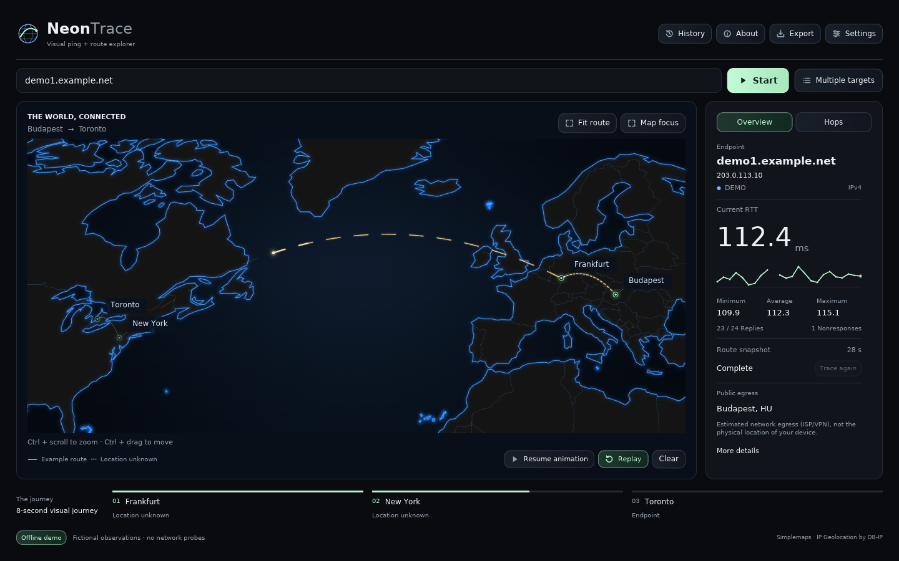

# NeonTrace

NeonTrace **1.1.0** is a native desktop app for visualizing ping measurements and observed network routes. A neon world map shows approximate hop locations, while an independently timed animation makes each route easy to follow.



## Download

Get the Windows portable ZIP, Linux tar.gz or Debian package from the [NeonTrace 1.1.0 release](https://github.com/Davoda1/Neon-Trace/releases/tag/v1.1.0). The release also includes source archives, an offline browser demonstration, operating notes and one `SHA256SUM.txt` file. [Build workflows](https://github.com/Davoda1/Neon-Trace/actions) show each build's status.

Supported targets are **Windows 11 x64** and **Linux amd64**, with an Ubuntu 24.04-equivalent or newer Linux baseline. A dedicated graphics card is not required.

- **Windows:** extract the ZIP and run `NeonTrace.exe` from its root.
- **Linux portable:** extract the tar.gz and run `neontrace` from its root.
- **Debian/Ubuntu:** install the `.deb`. It installs a regular executable at `/usr/bin/neontrace` and a desktop entry.

Binary packages contain the executable and required notices, with no launcher scripts or executable symlinks. Extract portable packages completely before running them.

## Explore a route

Enter a hostname, IP address or URL and select **Start**. A URL supplies its hostname; its page is not downloaded. NeonTrace pins the resolved endpoint address, starts endpoint ping measurements and independently discovers a route snapshot.

**Stop** cancels measurement and retains the results. **Clear** returns the stopped interface to its initial state while preserving preferences, installed databases and saved history. **Trace again** refreshes the route snapshot. **Pause animation** and **Replay** affect only the presentation, without sending probes.

The map automatically frames the route. Hold **Ctrl + scroll** to zoom around the pointer, or **Ctrl + drag** to move the map. Horizontal movement wraps and vertical movement is bounded. **Fit route** restores automatic framing. Select a map marker or hop card to inspect its observations.

Each complete outward animation lasts eight seconds and repeats until paused. Shorter drawn jumps take less time than longer jumps. The journey strip follows the active hop when needed; hovering or scrolling manually takes priority, with a four-second grace period before following resumes. Animation timing is illustrative, not a measured link delay.

**Multiple targets** accepts one to ten targets. Its full-width map and compact progress cards emphasize simultaneous animated routes; select a target or marker for detailed measurements. Switching back stops the group and restores the retained single-target view.

## Interface

- Overview and Hops views keep endpoint statistics separate from intermediate observations.
- About, Settings, History and Export use readable, content-sized panels.
- The normal window size, position and maximized state are remembered. Wayland desktops control window placement themselves.
- The app follows the operating system's light/dark preference, including changes while running.
- English, German, Hungarian, French, Italian and Russian are available.
- The interface supports windows down to approximately 680 × 540; panels scroll within the window.

## Read measurements accurately

- Curves connect estimated locations schematically; they are not cable paths.
- Ping measures a round trip to one endpoint. Separate hop-limit probes discover responding intermediate interfaces.
- Each hop RTT is measured from this computer to that responding hop. Adding or subtracting hop RTTs does not establish link latency.
- A missing intermediate reply can reflect filtering or rate limiting. It does not prove that forwarded traffic was lost.
- Unknown locations remain unknown. Country-only data does not become a city pin.
- A CDN or anycast address can identify an edge endpoint. No hidden origin connection is inferred.
- The optional TCP connection to port 443 is a separate connectivity check, not ICMP ping or a full website test.

The GUI runs without elevation. Probe support depends on the operating system, socket permissions, firewall and target response policy. Errors and incomplete routes remain visible.

## Data and privacy

First live use discovers the public network egress address through ipify over HTTPS and downloads the free DB-IP Lite City and ASN databases. **Target and hop addresses are looked up locally** and are not submitted to an online geolocation service. Database updates are checked monthly while the app is in use; failed updates retain the last valid cache. No account or API key is required.

The origin estimate may represent an ISP, VPN, proxy or carrier gateway rather than the computer's physical position. Missing geolocation data does not imply a missing network response.

History is disabled by default. Settings do not silently save queried targets or sessions. JSON, CSV and PNG exports are explicit actions and may contain targets and observations. No telemetry, advertising, remote crash reporting, permanent background service or automatic application-update checks are included.

Configuration lives in the per-user application directory (`%AppData%` on Windows and `~/.config` on Linux, respecting platform overrides). Downloaded databases are cached separately. Normal startup begins with measurement stopped. See [operating notes](docs/README-Notes.txt) and the [export schema](docs/export-schema.md) for details.

## Offline demonstration

Run `neontrace --demo` to explore fictional observations without resolving hosts, downloading data or sending probes. Add `--demo-targets=4` for four simultaneous example routes; one to ten are supported.

The release's standalone Preview HTML is a simplified offline browser illustration, not the native application. Its route data and timings are fictional, and entered target names are labels only. It makes no network requests.

## Build from source

The build workflow uses Rust **1.99.1**. Install Rust and the native dependencies for your target, then run:

```console
cargo build --release --locked
cargo test --release --locked
```

The executable is `target/release/neontrace.exe` on Windows or `target/release/neontrace` on Linux. `Cargo.lock` fixes the dependency graph.

On Ubuntu 24.04, install a C toolchain, `pkg-config`, X11/Wayland and xkbcommon development libraries, and Vulkan runtime support. The [build workflow](.github/workflows/verify.yml) lists the package dependencies. A desktop portal with a GTK or KDE FileChooser backend provides export dialogs.

For Windows MSVC, install Visual Studio Build Tools with **Desktop development with C++**, the MSVC x64/x86 tools, and a Windows 10 or 11 SDK. The resource compiler and SDK include directories are discovered automatically. An explicit `RC` environment variable can select a compiler executable. GNU cross-builds use `x86_64-w64-mingw32-gcc` and `x86_64-w64-mingw32-windres`.

`tools/dependency_notices.py` collects notices from the locked crate sources. `tools/package.py` creates the eight release files, validates archive layouts and executable signatures, checks the Linux glibc baseline and writes the checksum manifest. Packaging itself does not publish files.

## License and attribution

NeonTrace is [MIT licensed](LICENSE), copyright © 2026 Davoda1.

The world map comes from [Simplemaps](https://simplemaps.com/resources/svg-world) under its [MIT notice](assets/SIMPLEMAPS-LICENSE.txt). All 470 original polygon parts and 220 country/territory groups are retained. Antarctica is outside the supplied map coverage.

[IP Geolocation by DB-IP](https://db-ip.com/). DB-IP Lite City and ASN data use [CC BY 4.0](https://creativecommons.org/licenses/by/4.0/), with reduced coverage and accuracy compared with paid editions. Installed dataset metadata is retained with cached data and relevant exports.

Font, map and compiled dependency notices are included in [THIRD-PARTY-NOTICES.txt](docs/THIRD-PARTY-NOTICES.txt).
